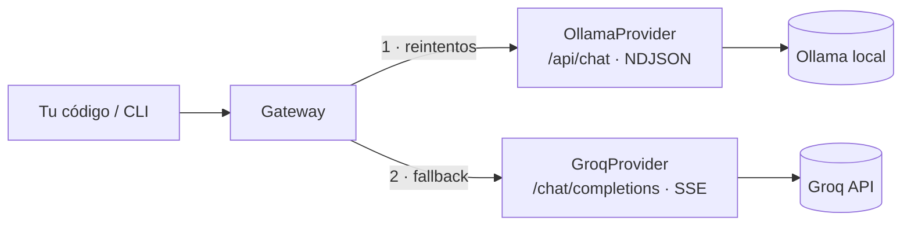

<div align="center">

# llm-gateway

**Cliente Python unificado para modelos de lenguaje locales (Ollama) y en la nube (Groq):
una sola interfaz, streaming, reintentos con backoff y *fallback* automático entre proveedores.**

[](https://github.com/DarwinMontiel/llm-gateway/actions/workflows/ci.yml)


[](LICENSE)

</div>

> **English summary** — A small, typed Python library and CLI that puts local LLMs (Ollama) and
> cloud LLMs (Groq, OpenAI-compatible) behind one interface. It handles NDJSON and SSE
> streaming, translates HTTP/transport failures into a clear error hierarchy, retries transient
> errors with exponential backoff (honoring `Retry-After`), and falls back from local to cloud.
> Fully tested offline with `httpx.MockTransport`, including a real captured Ollama stream.

---

## Por qué

En automatización con IA (clasificar correos de cobranza, resumir gestiones, extraer datos de
documentos) conviene usar un **modelo local** por costo y privacidad, pero tener un **modelo en la
nube** cuando el local no está disponible o la tarea es más difícil. Cada proveedor tiene su
propio formato de API, de streaming y de errores. `llm-gateway` los unifica.

Este repositorio nació como notas de laboratorio de *Sistemas Inteligentes* (2024) y se convirtió
en una librería con pruebas; las notas originales están en
[docs/guia-ollama-groq.md](docs/guia-ollama-groq.md).

## Uso

```python
from llm_gateway.config import build_gateway

gateway = build_gateway(["ollama", "groq"])          # local primero, nube de respaldo

answer = gateway.complete("Resume esta gestión en una frase: ...", system="Responde en español")
print(answer.text, answer.provider, answer.latency_ms)

for chunk in gateway.stream("Explica qué es una promesa de pago"):
    print(chunk, end="")
```

CLI:

```bash
pip install -e .
llm ask "¿Por qué el cielo es azul?"                 # auto: Ollama → Groq
llm ask "Hola" --provider groq --no-stream
llm compare "Explica el PAR30 en una frase"          # latencia y tokens de cada proveedor
llm models                                           # modelos descargados en Ollama
```

Configuración por entorno o `.env` (ver [.env.example](.env.example)): `OLLAMA_URL`,
`OLLAMA_MODEL`, `GROQ_API_KEY`, `GROQ_MODEL`, `TIMEOUT_SECONDS`. La clave se maneja como
`SecretStr`: no aparece en logs ni en `repr`.

## Diseño



| Situación | Comportamiento |
|---|---|
| Conexión rechazada, *timeout*, HTTP 5xx | `ProviderUnavailableError` → reintento con backoff (0,5 s, 1 s…) → siguiente proveedor |
| HTTP 429 | `RateLimitedError` → espera `Retry-After` → siguiente proveedor |
| HTTP 401/403 o falta la clave | `AuthenticationError` → **no** se reintenta ni se oculta |
| Todos fallan | `AllProvidersFailedError` con el error de cada proveedor |
| Streaming | *Fallback* solo si el proveedor falla **antes** del primer fragmento (nunca mezcla respuestas) |
| Modelo pedido | Se aplica al primer proveedor; los de respaldo usan su modelo por defecto |

Los proveedores implementan un `Protocol` (`complete` y `stream`), así que agregar otro (OpenAI,
Azure, Bedrock) es una clase nueva sin tocar el gateway.

## Pruebas

```bash
pip install -e ".[dev]"
pytest --cov            # 24 pruebas, sin red (httpx.MockTransport)
ruff check . && mypy src
```

Cubren el formato de cada API, el parseo de NDJSON y SSE (incluida una **captura real** de
Ollama), la traducción de errores HTTP y de red, los reintentos con `Retry-After`, el *fallback*
y que la clave no se filtre en `repr`.

## Estructura

```
src/llm_gateway/
├── types.py            # Message, Completion
├── errors.py           # jerarquía de errores
├── retry.py            # backoff exponencial
├── gateway.py          # cadena de proveedores con fallback
├── config.py           # settings (.env) y fábricas
├── cli.py              # llm ask | compare | models
└── providers/          # ollama.py (NDJSON), groq.py (SSE), base.py
examples/               # del primer laboratorio al gateway con fallback
docs/                   # guía de Ollama y Groq
```

## Autor

**Darwin Montiel Mora** — Desarrollador RPA & Backend · Ingeniero de Sistemas
[LinkedIn](https://www.linkedin.com/in/darwin-montiel-mora-925216206) · [GitHub](https://github.com/DarwinMontiel)

Licencia [MIT](LICENSE).
