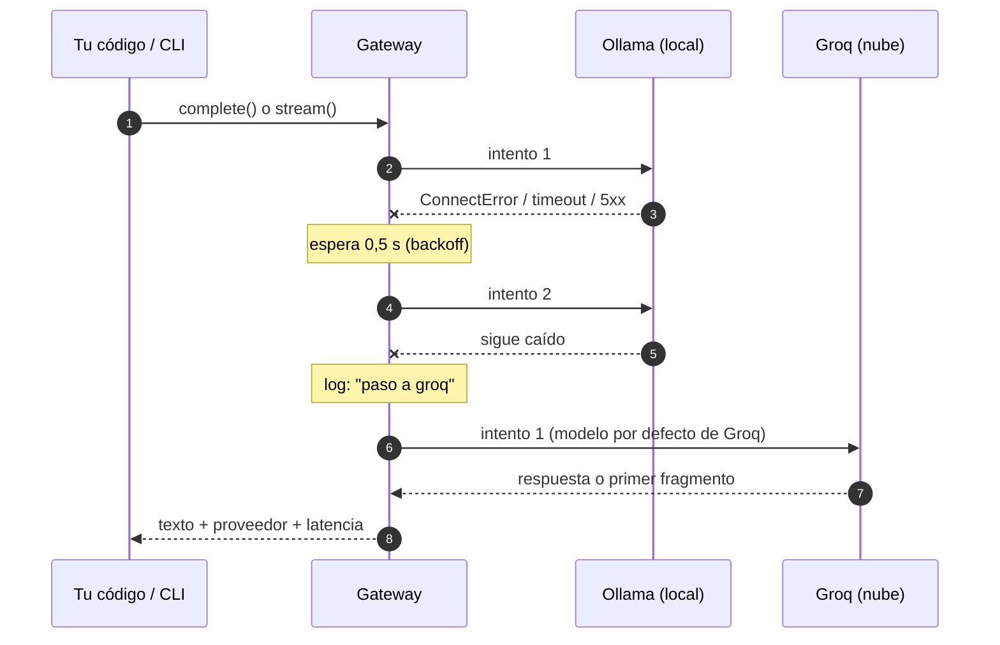

<div align="center">

# puente-llm

**Si el modelo local se cae, la nube toma el relevo.**

Cliente Python y CLI que pone un modelo de lenguaje **local** (Ollama) y uno **en la nube** (Groq)
detrás de una sola interfaz: streaming, reintentos con backoff y respaldo automático entre
proveedores.

[](https://github.com/DarwinMontiel/puente-llm/actions/workflows/ci.yml)


[](https://mypy-lang.org/)
[](LICENSE)

</div>

---

## Una noche cualquiera en cobranzas

> *Escena ficticia.* Son las 7:45 p. m. en *Cartera La Esperanza*, un call center inventado.
> Marta, coordinadora del turno, tiene que clasificar las notas de gestión del día antes del
> cierre: quién prometió pagar, a quién no se pudo localizar, quién dice que ya pagó. Un modelo
> **local** hace el trabajo sin que los datos salgan de la oficina… hasta que el servidor donde
> corre Ollama se reinicia por una actualización.

Sin un puente, el script de Marta se detiene con un `ConnectError`. Con `puente-llm`, el
cliente reintenta, y si el modelo local sigue sin responder, pasa a la nube y deja constancia
(salida ilustrativa; los avisos tienen el formato real del log):

```text
$ puente -v pregunta "Clasifica: el cliente promete pagar el viernes 15"
  · [ollama] no se pudo conectar (ConnectError); intento 2 de 2 en 0.5 s
  · [ollama] no se pudo conectar (ConnectError); paso a groq
promesa_de_pago
```

El caso real detrás de la escena es común en automatización: el modelo local conviene por costo
y privacidad, la nube conviene por disponibilidad, y cada proveedor tiene su propio formato de
API, de streaming y de errores. Esta librería los unifica y decide, con reglas explícitas,
cuándo reintentar, cuándo cambiar de proveedor y cuándo **no** ocultar un error.

## Uso

```python
from puente_llm.config import build_gateway

with build_gateway(["ollama", "groq"]) as puente:  # local primero, nube de respaldo
    resumen = puente.complete(
        "Resume esta gestión: contesta la titular, reconoce dos cuotas en mora y "
        "promete abonar la mitad el día 15.",
        system="Eres analista de cobranza. Responde en español, sin inventar datos.",
    )
    print(resumen.text, resumen.provider, resumen.latency_ms)

    for fragmento in puente.stream("Explica qué es una promesa de pago", model="llama3.2"):
        print(fragmento, end="")
```

Sin `GROQ_API_KEY` la cadena funciona solo con Ollama: el respaldo sin credenciales se omite con
un aviso en el log, en lugar de impedir el arranque.

### CLI

```bash
pip install -e .
puente pregunta "¿Qué es una promesa de pago?"           # auto: Ollama → Groq
puente pregunta "Hola" --proveedor groq --sin-stream     # muestra proveedor, modelo y latencia
puente -v pregunta "..." --modelo tinyllama              # --detalle: ver reintentos y respaldos
puente compara "Explica el PAR30 en una frase"           # latencia y tokens de cada proveedor
puente modelos                                           # modelos descargados en Ollama
```

La ayuda (`puente --help`) está en español. Los nombres anteriores (`ask`, `compare`, `models`)
siguen funcionando como alias ocultos.

### Configuración

Por entorno o archivo `.env` (ver [.env.example](.env.example)): `OLLAMA_URL`, `OLLAMA_MODEL`,
`GROQ_API_KEY`, `GROQ_MODEL`, `TIMEOUT_SECONDS`. La clave se maneja como `SecretStr`: no aparece
en logs ni en `repr`.

## Cómo decide



El semáforo de errores:

| | Situación | Comportamiento |
|---|---|---|
| 🟢 | Conexión rechazada, *timeout*, HTTP 5xx | `ProviderUnavailableError` → reintento con backoff (0,5 s, 1 s…) → siguiente proveedor |
| 🟡 | HTTP 429 | `RateLimitedError` → espera `Retry-After` (segundos o fecha HTTP) → siguiente proveedor |
| 🔴 | HTTP 401/403 o falta la clave | `AuthenticationError` → **no** se reintenta ni se oculta |
| ⚫ | Todos fallan | `AllProvidersFailedError` con el error de cada proveedor |

Reglas adicionales:

- **Streaming:** los reintentos y el respaldo solo ocurren **antes** del primer fragmento. Si la
  respuesta ya empezó, un fallo se propaga: nunca se mezclan dos respuestas distintas.
- **Modelo pedido:** se aplica al primer proveedor; los de respaldo usan su modelo por defecto
  (cada proveedor tiene su catálogo).
- **Conexiones:** el gateway y los proveedores se usan como *context manager* y cierran sus
  clientes httpx; un cliente inyectado lo cierra quien lo creó.

Los proveedores implementan un `Protocol` (`complete` y `stream`), así que agregar otro
(OpenAI, Azure, Bedrock) es una clase nueva sin tocar el gateway.

## Ejemplos

| Archivo | Qué muestra |
|---|---|
| [01_ollama_http_basico.py](examples/01_ollama_http_basico.py) | El punto de partida: una llamada HTTP directa a Ollama, sin manejo de errores. |
| [02_respaldo_local_nube.py](examples/02_respaldo_local_nube.py) | Resumir una gestión y proponer el siguiente paso, con respaldo y logs visibles. |
| [03_clasificar_gestiones.py](examples/03_clasificar_gestiones.py) | Clasificar [12 notas ficticias](examples/datos/gestiones_ficticias.csv) en una lista cerrada de etiquetas; lo que no encaja queda para revisión humana. |

## Pruebas y calidad

```bash
pip install -e ".[dev]"
pytest --cov            # 59 pruebas, sin red (httpx.MockTransport)
ruff check . && ruff format --check . && mypy src
```

Cubren el formato de cada API, el parseo de NDJSON y SSE (incluida una **captura real** de
Ollama), la traducción de errores HTTP y de red, `Retry-After` en sus dos formatos, los
reintentos y el respaldo en `complete` y en `stream`, el modo local sin clave de la nube, el
cierre de conexiones, el CLI y que la clave no se filtre en `repr`. El CI corre en Python 3.11,
3.12 y 3.13, exige 90 % de cobertura y construye el paquete.

## Qué demuestra

- **Diseño para fallar bien.** La misma disciplina que aplico en bots RPA que dependen de
  portales externos: clasificar el error (transitorio, de cuota, de credenciales), reintentar
  solo lo que vale la pena y dejar rastro en el log de cada decisión.
- **Contratos explícitos.** Un `Protocol` para los proveedores, una jerarquía de errores propia y
  tipado estricto con mypy; el código que usa la librería no conoce los formatos de cada API.
- **Pruebas sin red.** Todo se prueba con `httpx.MockTransport` y una captura real, así que el CI
  no depende de Ollama ni de una clave.
- **Criterio con la IA.** El modelo clasifica contra una lista cerrada y lo que no encaja va a un
  humano; en cobranza, una etiqueta inventada tiene consecuencias.

**Relación con mi experiencia.** Trabajo como desarrollador RPA & Backend en una fintech de
gestión de cartera, donde construyo bots en Python con colas, reintentos e idempotencia. Antes
pasé por una línea de cobranzas de un BPO, de ahí el dominio de los ejemplos. Este proyecto
nació como notas de laboratorio de *Sistemas Inteligentes* (2024) —conservadas en
[docs/guia-ollama-groq.md](docs/guia-ollama-groq.md)— y lo convertí en una librería con esos
mismos criterios de producción.

## Decisiones de diseño

| ADR | Decisión |
|---|---|
| [0001](docs/adr/0001-protocolo-de-proveedores.md) | Proveedores como `Protocol` y errores propios en lugar de un SDK por proveedor |
| [0002](docs/adr/0002-respaldo-antes-del-primer-fragmento.md) | En streaming, reintentar y cambiar de proveedor solo antes del primer fragmento |
| [0003](docs/adr/0003-respaldos-sin-credenciales.md) | Un respaldo sin credenciales se omite; un proveedor principal sin credenciales falla al usarse |

## Estructura

```
src/puente_llm/
├── types.py            # Message, Completion
├── errors.py           # jerarquía de errores
├── retry.py            # backoff exponencial con Retry-After
├── gateway.py          # cadena de proveedores con reintentos y respaldo
├── config.py           # settings (.env) y fábricas
├── cli.py              # puente pregunta | compara | modelos
└── providers/          # ollama.py (NDJSON), groq.py (SSE), base.py
examples/               # del primer laboratorio al clasificador de gestiones
docs/                   # guía de Ollama y Groq, decisiones de diseño (ADR)
```

## Ecosistema

Forma parte de un portafolio sobre automatización de cobranza. Las notas que clasifica son del
tipo que registra [faro-cobranza](https://github.com/DarwinMontiel/faro-cobranza) (CRM de
cobranza), y su manejo de fallos sigue el mismo criterio que los bots de
[colmena-rpa](https://github.com/DarwinMontiel/colmena-rpa): clasificar el error antes de decidir
si se reintenta.

## Autor

**Darwin Montiel Mora** — Desarrollador RPA & Backend · Bogotá, Colombia
[LinkedIn](https://www.linkedin.com/in/darwin-montiel-mora-925216206) · [GitHub](https://github.com/DarwinMontiel)

Personas, empresas y notas de los ejemplos son ficticias. Licencia [MIT](LICENSE).
